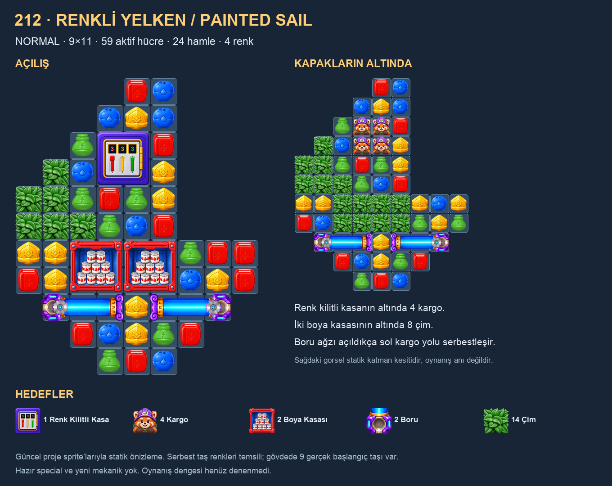

# 212 · Renkli Yelken / Painted Sail

2026-11-03 · Normal · V1 `LevelCL_0212` · **inceleme taslağı; kullanıcı henüz oynamadı/onaylamadı**.

## Fikir ve görünüm

Tekne gövdesi ve sola açılan üçgen yelken, **9×11 sınır içinde 59 aktif hücre** oluşturur. Üstte renk kilitli kasa yelkenin odağıdır; sol kenardaki bağlı çim üçgeni eğimi tamamlar. Alt güvertede iki bitişik boya kasası, gövdede birbirine bakan iki boru bulunur. En alttaki taş haznesi teknenin daralan omurgasıdır. 211'in duvar/taş/dolap düzeni ve son seviyelerin dört-oda/kanat şablonları tekrarlanmadı.

Engel seçmeden önce güncel kütüphanenin 76 ID tanımı ve V1 kullanım geçmişi envanterlendi. Bu sayı bağımsız mekanik sayısı değildir; yön/renk/aşama, ürün ve eski tanımlar da içerir. Üç aday fikirden **Magnetic Dockyard** (mıknatıs uçları ve kafesleriyle kargo rotası), **Painted Sail** (kasa–kargo–boya–boru ilişkisi) ve **Paint Wheel** (radyal boya/mühür odaları) değerlendirildi. Yelkenli, okunaklı çıkış zinciri ve ayrı silueti nedeniyle seçildi. Çark fikri yakın 209'un dört odalı düzenine fazla yaklaşıyordu. Mıknatıs başka tasarımlarda kullanılabilir; bu seçim o aileyi yasaklamaz.

## Birbirine bağlı işler

1. **Renk kilitli kasa → kargo:** 2×2 kasa altında dört kargo var. Sıra kırmızı → sarı → yeşil; sayaçlar **3/3/3**. Güncel SafeObstacleService yerel vuruş kaynağını işler; mühür gibi board genelinde renk topladığı varsayılmadı. Kasa açılınca kargo görünür ve düşüşe katılır.
2. **Boya kasaları → çim:** güvertedeki iki 2×2 boya kasasının her birinde dokuz kutu var. Normal isabet bir, special isabeti iki kutu indirir. Altlarında toplam **8 çim** bulunur. Kargo bu sütunlardan geçeceği için boyayı temizlemek tek başına bitiş değildir.
3. **Boru → çıkış yolu:** gövdede iki adet üç hücrelik yatay boru var. Açık uçları içeri bakar. Soldaki borunun ilk küçülen hücresi sol kargo sütununu açar; sağ kargo sütunu orta açıklığı kullanır. İki borunun tamamı ayrıca hedeftir. Kargo kırılarak toplanmaz; yalnız düz düşüş ve alt çıkışla sayılır.

Bunlar zorunlu tek komut sırası değildir. Oyuncu renk kilidine hazırlanırken güverteyi veya boruları da çalışabilir. Beş ayrı aile aynı sevkiyat işinin parçalarıdır; çeşitlilik için ilgisiz engel eklenmedi.

| Ayar | Değer |
|---|---|
| Hamle / renk | **24 / 4**, ilk denge ayarı |
| Hedefler | **1 Safe · 4 Cargo · 2 PaintCanBox · 2 Tube · 14 Grass** |
| Çim | 6 görünür yelken hücresi + boya altında 8 |
| Başlangıç taşları | 32 yuva doğal beslenir; kapalı gövdeye **9 gerçek renk pini** kondu |
| Serbest eşleşme alanı | 35 yuva; çim üzerindeki kilitli taşlar hariç |
| Hazır special | Yok |
| Refill special guard | 0.75; mevcut runtime yardım davranışı değiştirilmedi |

## Akış ve doğrulama

Borular/kapaklar yerindeyken alt gövdedeki dokuz yuva üstten beslenmez. Bunlar rastgele dolmuş gibi çizilmedi: assette dört renkten dokuz başlangıç taşı var, başlangıç üçlüsü/2×2 özel eşleşmesi yok ve dolu haznede ilk gravity için boş alt yuva bırakılmıyor. Kapaklar açılınca normal besleme rotası mevcut. Sol kasa kenarında tek kullanışsız taş bırakmamak için iki çim hücresi iç taslak sırasında kaldırıldı; yelken ve çim hedefi buna göre 16→14 güncellendi. Bu ajan değerlendirmesidir, kullanıcı reddi/onayı değildir.

`Batches/212-Painted-Sail/verify.py` gerçek YAML'ı Ruby/Psych ile okur; 99 hücrelik dizileri, bağlı maskeyi, örtülerin ayak izlerini/originlerini, beş hedefin miktarlarını, boru yönlerini ve açılış pinlerini kontrol eder. Safe'in blok durumu servis tarafından belirlendiğinden, yalnız library'deki `blocksCells=0` alanına bakılarak kasanın içi serbest taş alanı sayılmaz. Kargo sütunları **3 ve 4** (0 tabanlı) boyunca en alt satıra kadar kesintisiz aktif hücrelere sahiptir; arada kalıcı üretici veya çıkışsız hole yok. Statik başlangıç/kapak kaldırma kontrol noktaları bütün taş yuvaları için doğal besleme veya yazılmış pini doğrular. Bunlar hamle/gravity/kaskat simülasyonu değildir.

211 önceki V1 level, board konumu ve engelin kendi sınırına kırpılmış siluetiyle karşılaştırıldı. Yakın adaylar 110/151/115 ve boru grupları nedeniyle 179/165; ayrıca 203/209/211 görselleri incelendi. 212'nin üçgen yelken–tekne şekli ve örtülü kargo rotası farklı bir kompozisyon kurar. Skorlar yalnız aday bulur; yenilik veya kullanıcı beğenisi yüzdesi değildir. Görseller güncel sprite ve prefab parçalarıyla üretildi; serbest taş renkleri temsili, gövdedeki dokuz renk ise assette gerçektir. Sağdaki önizleme katman kesitidir; kargonun gravity sonrası konumu olduğu iddia edilmez.

## Koruma ve sınırlar

Yalnız yeni 212 asseti/meta'sı eklendi, V1 kataloğu bir entry uzatıldı ve `LevelNames.json` içine TR/EN adı yazıldı. Önceki isimler ve assetler hash ile korundu. **211'in kullanıcı tarafından belirlenen 24 hamlesi aynen korundu** (kullanıcı bu değişikliğin kendisine ait olduğunu doğruladı). Başlangıç kayıtları `Batches/212-Painted-Sail/Before/` ve `baseline.json`; sonuçlar `validation.json`, aile seçimi `Pool-Review.json`, görsel karşılaştırma `Comparison.png` içindedir.

Runtime/VFX/audio kodu değişmedi. Bir Safe, iki boru, iki boya kasası ve mevcut kargo/çim akışı kullanılır. Boya görünümü kurulumda 18 kutu görseli oluşturur; var olan slotları kullanır ve düşen kutuları mevcut ObstacleScatterFx yoluna gönderir. Safe/Tube görsellerinin kurulum ve mevcut animasyon maliyetleri kalır; tamamen havuzlu veya ölçülmüş FPS iyileşmesi iddia edilmiyor. Yeni per-frame tarama, update döngüsü, coroutine veya ses kaynağı eklenmedi.

**Oynanmış denge ve ölçülmüş geçiş oranı yok.** Unity Play/build, bot/kaskat simülasyonu, upload/publish veya release baseline yapılmadı. 24 hamle kullanıcı oyunuyla kalibre edilecek. Kullanıcı istemeden 213'e geçilmez; değişiklikte güncel assetten yeni snapshot alınır.
