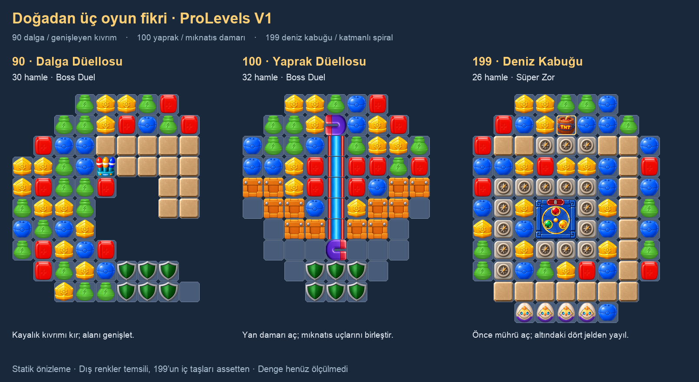

# ProLevels V1 — 90 / 100 / 199

2026-10-29. **199 v3:** kullanıcı mevcut seviyeyi kolay buldu; 2./3. satırdaki yalnız jellerin kaldırılmasını ve 2×2 Ancient Seal altına dört jel konmasını istedi. 26 hamle ve diğer içerik korundu. Önceki v2 `Revisions/199-v2/`, v1 `Revisions/199-v1/` altında korunur.

Kullanıcının yeni tasarım isteği: acele yerleştirme yerine oynama keyfi,
görünür açılma olayı ve doğadan şekiller. Üç tasarım **inceleme taslağıdır**; kullanıcı
onayı, oynanış dengesi veya ölçülmüş kazanma oranı henüz yok.

| V1 | İsim / EN | Tahta | Hamle | Ana fikir |
| --- | --- | --- | --- | --- |
| 90 | Dalga Düellosu / Tidal Duel | 9×10, 65 aktif | 30 | Kayalık kıvrım açıldıkça büyüyen düello alanı |
| 100 | Yaprak Düellosu / Leaf Duel | 9×10, 70 aktif | 32 | Yaprağın orta mıknatıs damarı ve yan damarlar |
| 199 | Deniz Kabuğu / Seashell | 9×11, 87 aktif | 26 | Özel vuruşlu iç spiral, oyma dış kabuk ve jel kaplama |

## 90 — Dalga Düellosu

- Maske dalganın kıvrımını ve sağdaki açık koyu oluşturur. Başlangıçta 44 normal taş
  yuvası, 13 üç-vuruşlu SculptingStone28, tek RocketBasket38 ve alt dudakta 6 oyuncu
  kalkanı35 vardır. 1 yuva başlangıçta dolmaz; önizlemede boş bırakıldı.
- İlk karar: açık solda büyük eşleşme kurmak mı, kıvrımın ağzındaki sepeti şarj edip
  kayaları aşındırmak mı? Sepet kırmızı/sarı/mavi eşleşmelerde birer roket verir;
  her vuruşta tüm roketleri fırlatma ayarı kapalıdır. Hazır special yoktur.
- Kıvrım ve sepet tamamen açıldığında normal dolum yuvası 44→59 olur. Bu bir
  karşı-olgusal geometri kontrolüdür; tek hamle veya garantili roket hedefi değildir.
- Tek bitiş hedefi **420 BossDamage**. Üç rakip: **126 / 139 / 155 HP**;
  karşılık hasarları **7 / 8 / 8**, oyuncu HP **180**. İlk rakip engel atmaz;
  sonraki ikisi her 4 karşı saldırıda 1 / 2 engel atar. Havuz Oil14 + Porcelain30,
  baskı tavanı6, yağ yayılma tavanı8. Alet tehdidi kapalı.
- Kayaların hepsini temizlemek ayrıca zorunlu hedef değildir; düello bittiğinde
  kalan engelleri temizlemeye zorlayan bir son bölüm yoktur.

## 100 — Yaprak Düellosu

- Yaprak silueti, ortasında 7 hücrelik tek mıknatıs yolu ve ona yaklaşan 12
  iki-aşamalı sandıktan oluşan iki bağlı yan damar. Sapın altında 6 kalkan35.
  Başlangıçta 33 normal taş yuvası; alt bölgede 12 yuva gerçekten boş.
- Üst mıknatıs ucu hemen komşu taşlardan vurulabilir. Alt uç başlangıçta yan damar
  arkasındadır; damar açılınca normal vuruş erişimi oluşur. Mıknatısı birleştirince
  merkezde uzun, dolum alan bir taş hattı kazanılır (normal yuvalar 33→44).
- Mıknatısın yanına üretilen special'ı bekletmek kafeslenme riski taşır. Karar yalnız
  daha çok vuruş yapmak değil: special'ı şimdi kullanmak veya damarı önce açmaktır.
- Tek bitiş hedefi **480 BossDamage**. Üç rakip **144 / 158 / 178 HP**;
  karşılık hasarları **7 / 8 / 9**, oyuncu HP **210**. Her4 karşı saldırıda
  1 / 1 / 2 engel; havuz Oil14 + Porcelain30 + PlasticTwoStage40.
  Baskı tavanı7, yağ yayılma tavanı10. Alet tehdidi ve hazır special yok.
- Mıknatıs ve sandıklar alan kazanma araçlarıdır; ayrıca son temizlik hedefi değildir.

## 199 — Deniz Kabuğu

- Yuvarlatılmış dış maske içinde 34 hücrelik kesintisiz spiral: 17 adet üç-vuruşlu
  SculptingStone28 ve 17 adet yalnız-special, tek-vuruşlu SculptingSpecial39.
  Komşuluk vuruşunun 39'u açacağı varsayılmadı; güncel library kontrol edildi.
- Üstte jelsiz tek hazır TNT, sabit üç pusulanın oluşturduğu zayıf ağzın
  üstünde durur. Alttaki katı kapak sayesinde başlangıçta düşmez. Güncel PulseCore
  5×5 alanı bu üç kapıyı kapsar; çevredeki oyma taşları da hasar alabilir.
- Başlangıçta açık jel yoktur. Dört jel seed'i merkez mührün 2×2 ayak izinde
  (indeks48/49/57/58) saklıdır; mühür açılmadan sayılmaz ve yayılmaz.
  2./3. satırdaki eski jel tabanları13/21/22/23 temizlendi; üstteki üç pusula
  `stackedObstacles` içinde aynı kaldı. Açılışta44 normal taş + 1 hazır TNT ve
  4 tabana oturmuş yumurta-kuş vardır; boş normal yuva yoktur.
- Ağız açıldığında yukarıdan yenilenebilen yuvalar **27→41** olur. İç taşlar artık
  baştan vardır; bu sayı ilk taş görünümü değil dolum bağlantısıdır. TNT harcanır.
  İç18 taşın ve ağız sınırının renkleri assetten çizilir; dış renkler temsili,
  küçük açılma planı kaskat sonucu değildir.
- Merkezdeki tek 2×2 AncientSeal64 **8 kırmızı → 8 sarı → 8 yeşil** toplar.
  `GridSpawner.StampAncientSealEntry` dört jel tabanını mevcut beneath store'da
  korur. Önce mühür tamamlanır; ardından açılan jellerden kaplama işi başlar.
  Alt sıradaki dört EggBird45 orta/son bölümde yardımcı uçuşlar sağlar. Yumurtalara
  doğrudan temizlik hedefi eklenmedi; kuş hedeflerinin rastgeleliği korunur.
- Hedefler **87 jel kaplama / 17 pusula / 1 antik mühür**. Jel hedefi hole'ları
  dışlar, sonradan açılan oyma taşı ve mühür hücrelerini kapsar. Jelsiz special'ın
  otomatik jel yayacağı varsayılmaz. Dış kabuğu açmak tek başına bitiş değildir.
- **26 hamle korunmuştur (v1'de31).** İç taşlar oyuncuya daha erken eşleşme
  alanı da sağlar; beş hamle azaltmanın net etkisi yeniden oynanmalıdır. Zorluk, katman/kaplama işinin ve special kaynağının
  birlikte planlanmasından gelir; imkânsızlığın veya kazanılabilirliğin kanıtı değildir.

**v3 kapsam/doğrulama:** Assette yalnız `obstacles` ve `obstacleOrigins` dizileri
değişti. Görünen engel düzeni ve başlangıç taşları aynı; dört jel artık tamamen
mühür altındadır. Jel hedefi87, pusula17, mühür1 ve bütün renk sayaçları korundu.
Güncel çalışma alanından3.334 diğer dosyanın hash'i (tamamlanmış UI ses düzeltmesi,
90/100, katalog/isimler dahil) korunur. Yeni runtime/VFX kodu yok; ek engel veya
efekt kaynağı üretilmedi. Mevcut jel/mühür sistemlerinin çalışma maliyeti değişikliği
ölçülmedi. PNG ve statik katman kontrolleri yapıldı; Play/build/bot/kaskat veya
ölçülmüş zorluk testi yapılmadı. v3 henüz kullanıcı tarafından oynanıp onaylanmadı.

## Tekrar, ilerleme ve koruma

- Aktif V1 kataloğunda 90 için89, 100 için99, 199 için197 önceki bağlı kayıt
  tarandı. Konum, yansımalar ve kendi sınırlarına kırpılmış engel kütleleri incelendi.
  Sayısal benzerlik bir yenilik/beğeni yüzdesi olarak kullanılmadı.
- [15 tahta karşılaştırması](../../Reviews/ProLevels-V1-090-100-199/Comparison.png)
  ve [inceleme notu](../../Reviews/ProLevels-V1-090-100-199/Review.md).
- Seçilen bütün engeller V1'de daha önce kullanılmıştır; yeni mekanik tanıtılmaz.
  İlk kullanım kayıtları `obstacle-unlocks.json` içindedir. 199 kullanıcının verdiği
  havuzun dışına çıkmaz; yeni ColorCrate71–74 kullanılmaz.
- Yeni assetler `ProLevels/LevelV1_00000900.asset`, `00001000.asset`, `00001990.asset`.
  Yalnız üç boş katalog referansı dolduruldu. Gerçek anahtarlar **LevelCL_090 /
  LevelCL_0100 / LevelCL_0199** korundu; TR/EN isimler bu anahtarlarla eklendi.
- 3.098 mevcut asset/kod/kaynak dosyası hash ile korundu. Önceki isimler ve katalog
  kayıtları birebir korunur. Kullanıcının onayladığı11–15 ve önceki190/200 değişmedi.
  Snapshot'lar `Before/`; yeni dosya GUID/hash kaydı `manifest.json`.

## Performans ve doğrulama sınırı

- Yeni runtime, VFX, ses, board taraması veya pooling kodu yazılmadı. Merkezî ses
  sistemine ve mevcut köşe/border çözümüne dokunulmadı. Boss'lar10 satır sınırında.
- Yük sınırlı tutuldu: 90'da1 sepet (toplam3 roket), 100'de1 mıknatıs yolu,
  199'da1 mühür ve4 kuş (en fazla12 dalış). GelLauncher/WaterTank/çok sayıda
  üretici veya tüm-board yardımcı patlama zinciri eklenmedi.
- Mevcut maliyetler yok sayılmadı: RocketBasketLaunchAction atış başına geçici
  listeler kullanır; EggBirdHatchAction hedef havuzuyla birlikte board'u tarar ve
  geçici listeler/HashSet yaratır; kuş görsellerinin oluşturma/yok etme maliyeti var.
  Magnet cage/carrier görsellerinde de mevcut GameObject üretimi bulunur. Bunlar
  bu görevde yeniden uygulanmadı; bütün efektlerin havuzlu olduğu iddia edilmez.
- Magnet OnDisable abonelikleri/kafes görsellerini ve bekleyen rutinini temizler.
  AncientSeal OnDisable aboneliği kaldırır, uçuş işlerini Dispose eder ve break
  hold'ları bırakır; EggBird eylemi board/level kimliğini kontrol edip finally'de
  uçuşu temizler. Bunlar kaynak incelemesidir; cihaz teardown testi değildir.
- `audit.py --assets`: array uzunlukları, mask/bağlılık, origins/footprints,
  katmanlar, goal miktarları, YAML ayrıştırma, custom path, wave verisi, isim/GUID,
  başlangıç special/movable konumları, kapak sonrası dolum ve önceki dosya koruması
  geçti. PNG'ler açılıp incelendi. V2'de eklenen renklerin iç odada ve rastgele dış
  renklerle sınırda başlangıç üçlüsü/2×2 yaratamayacağı kontrol edildi. Bütün görünür
  yuvalar dolu olduğundan başlangıçta taşların düşebileceği boş hedef yoktur.
- **Unity Play/build, bot/kaskat simülasyonu, remote yayın/release baseline yok.
  Gerçek telefon FPS'i ve kazanma oranı ölçülmedi.**

### 199 v2 kapsam ve performans

Yalnız199 assetinde `moves` ve `pinnedTileTypes` değişti. Maske, spiral, hedefler,
mühür sayaçları, gel seed'leri, dört kuş, mevcut tek TNT, GUID ve isim aynı.
90/100, katalog, isim JSON'u ve3.107 diğer dosya revizyon öncesi hash ile korundu.
İlk açılışta18 ek normal tile view mevcut GridSpawner.SpawnTile yolunda Instantiate
ile oluşturulur; bu ilk kurulum maliyetidir, havuzlu olduğu iddia edilmez. Yeni Update,
board taraması, efekt veya runtime değişikliği yok. Bunun cihaz FPS maliyeti
ölçülmedi. Unity Play/build veya bot/kaskat simülasyonu yapılmadı.
