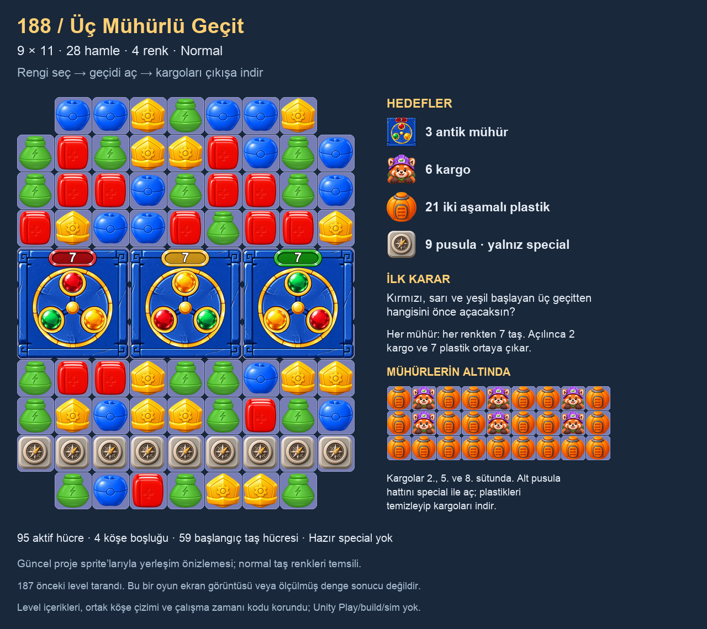

# 188 — Üç Mühürlü Geçit

Katalog: **188 / LevelCL_0188 / Chapter 8**. Asset: [LevelP_001920.asset](../../Assets/_Project/Settings/ProductionLevels/LevelP_001920.asset). **28 hamle, Normal, dört renk.** İlk denge ayarıdır; oynanmış veya kullanıcı tarafından onaylanmış sayılmaz.

## Oyun fikri

Ortada yan yana üç 3×3 AncientSeal, tek bir geçit bandı oluşturur. Soldaki kırmızı, ortadaki sarı, sağdaki yeşil toplamayla başlar. Her mühür sırasıyla üç rengin her birinden 7 taş ister; toplam 63 renk kredisi vardır. Oyuncu başlangıçtaki renk seçimiyle hangi kapının önce açılacağını etkiler. Sonraki aynı-renk talepleri mevcut servisin origin/odak önceliğiyle dağıtılır; eşit paylaşım veya tek hamlede tüm mühürleri açma varsayımı yapılmadı.

Her mührün altında **iki Cargo ve yedi PlasticTwoStage** vardır. Mühür açılınca üst ve alt eşleşme alanları o geçit üzerinden birleşir; kargoların altındaki plastiklerin de kaldırılması gerekir. Kargolar yalnız düz aşağı iner. 2., 5. ve 8. sütundaki yolların tamamı maskede aktiftir; 10. satırdaki kesintisiz dokuz pusula, çıkışları special ile açma işini bırakır.

| Hedef | Adet | Açılış durumu |
| --- | ---: | --- |
| AncientSeal 64 | 3 | Görünen bitişik 3×3 paneller; renk başına 7 |
| Cargo 34 | 6 | Her panelin altında aynı sütunda iki kargo |
| PlasticTwoStage 40 | 21 | Her panelin altında yedi; iki vuruş |
| SculptingSpecial 39 | 9 | Çıkışların üzerindeki tek kesintisiz satır; yalnız special |

95 aktif hücre ve dört dış köşe boşluğu vardır. Açılışta **59 normal taş hücresi**: üstte 34, mühürlerin altında iki satırda 18, en altta yedi. Üstteki alan doğrudan beslenir; alttaki 25 hücre başlangıçta doldurulur ve önündeki kapaklar açılana dek üstten doğrudan beslenmez. Bu hücrelerin hepsi başlangıçta üst kaynağa bağlıymış gibi değerlendirilmedi. Mühürler renk toplama yoluyla uzaktan açılabildiğinden alt cepte ilk hamleden oynanabilir eşleşme olması çözümün önkoşulu değildir.

Hazır special, sabit başlangıç rengi, yeni renkli sandık, dolap, boya kutusu, su kanalı veya çamur eklenmedi. Hedef adedi mevcut toplamla eşit; alt katmandaki kargolar/plastikler runtime beneath sayımına dahildir, ilave hedef dolum kotası yoktur. Düşüşten sonra plastik diziliminin sabit kalacağı söylenmez.

## Katalog incelemesi ve tekrar sınırı

1–187'nin tamamı maske, katman, özel yerleşim ve engel ailesi açısından tarandı; altı yerleşim haritası görsel olarak incelendi. Her level ayrı ayrı oynanmadı. En yakın kütleler 143, 107, 123, 32 ve 28; kırpılmış şekillerde 110, 6 ve 37 öne çıktı. 143/107/123/110, eski mühür örneği 149, kargo örneği 173 ve kullanıcı levelları 186–187 mevcut sprite parçalarıyla ayrıca karşılaştırıldı. Karmaşık tarihsel engellerin bazı görünüşleri sadeleştirilmiş şemadır; gerçek runtime ekranı değildir.

- 143'te tek büyük yatay mühür ile lazer/çamur katmanı var; yatay bir kapak fikri yeni diye sunulmaz. 188 üç ayrı renk hedefi ve üç kargo çıkışı kurar.
- 149'da dört köşe mührü, yumurta/taş ve jel var. 188'de tek bitişik bant, kargo indirme ve çıkış satırı var.
- 173'te Cargo + PlasticTwoStage zaten birlikte kullanıldı. 188'de yenilik bu iki ailenin ilk kez yan yana gelmesi değildir; mühür altında açılma ve special ile çıkış hazırlama ilişkisidir.
- Tarama, önceki katalogda AncientSeal + Cargo birlikteliği bulmadı; bu tek başına özgünlük veya kullanıcı beğenisi kanıtı sayılmaz.

Diğer düşünülen yönler: dört köşe mührü 149'u fazla tekrar edecekti; yeni su/boya basamakları 184/187'ye fazla yakındı. Mevcut bitişik üç kapı ve çıkış fikri seçildi. [Karşılaştırma](Reviews/188-Catalog/Comparison.png), [tarama ve kapsam](Reviews/188-Catalog/Review.md).

## Doğrulama ve performans sınırları

[Statik doğrulama](Batches/188/validation.json): boyut/diziler, maskenin tek bileşen olması, footprint ve origin'ler, çakışmayan mühür bölgeleri, doğru alt içerik/hedef toplamları, gerçek Cargo çıkışları, renk havuzu, special erişimi, tanıtım sırası, katalog/GUID ve isim eşleşmesi geçti. 2.788 önceki Settings/Scripts/Resources/Scenes/Prefabs dosyasının hash'i aynı. 186–187 kullanıcı tasarımları ve önceki runtime düzeltmeleri korundu; ortak board köşe çizimi değiştirilmedi.

Bu level yeni runtime/VFX kodu veya her kare taraması eklemez. Var olan taş havuzu kullanılır. Üç mühür, mevcut toplama uçuşları ve kırılma görsellerini kullanır; koleksiyon/ghost üretiminin mevcut maliyetleri devam eder. Renk kredileri ve sahne kapanışı mevcut AncientSealService/AncientSealView temizleme yolundadır; yeni event aboneliği veya coroutine eklentisi yoktur. Cihaz performansı ölçülmedi.

Unity Play/build, bot veya cascade simülasyonu yapılmadı. %40–50 yönü tasarım hedefi olarak korunur; bu level için kazanma oranı veya tamamlanabilirlik ölçümü değildir. 28 hamle kullanıcı oynanışından sonra ayarlanabilir. Bir sonraki 189 kullanıcı istemedikçe tasarlanmaz.
