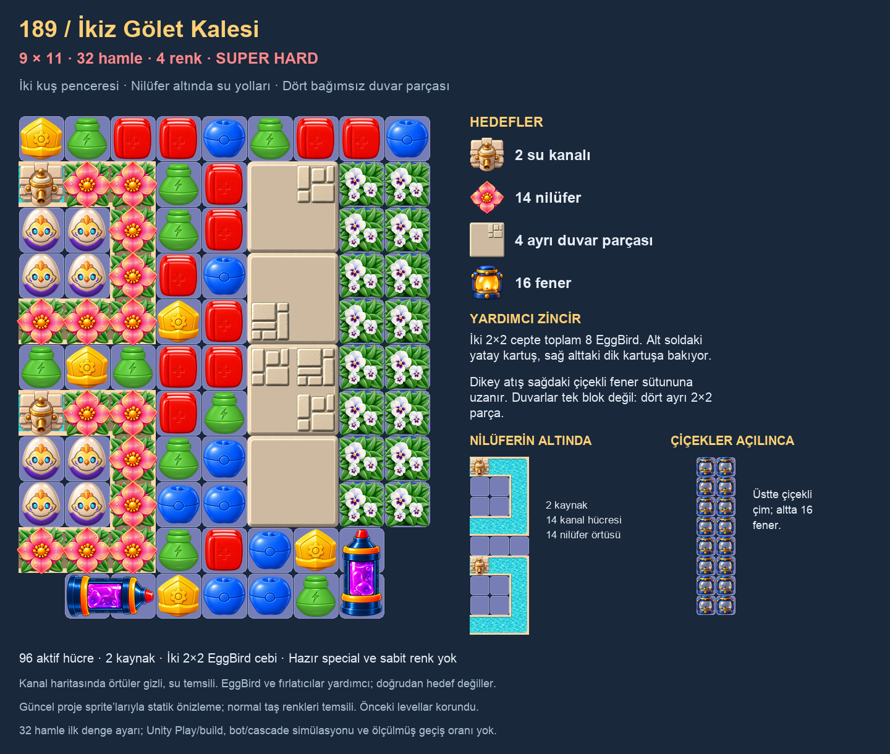

# 189 — İkiz Gölet Kalesi

İnceleme taslağı · 32 hamle · Super Hard · 9×11 · 96 aktif hücre. Katalog `LevelCL_0189`, asset `LevelP_001930.asset`, chapter8. İsim kalıcı JSON ve isim listesine işlendi.

## Kompozisyon ve oynama kararı

Solda iki C biçimli nilüferli su kanalı, her birinin içinde 2×2 EggBird penceresi var. Kullanıcının “boşluk” sözü, nilüfer kaplaması bulunmayan oynanabilir kuş pencereleri olarak yorumlandı; bunlar gerçek hole değil. İki kaynak boş, 14 diğer kanal hücresinin tamamında nilüfer üst katmanı bulunur. Açılan kanallar normal oynanabilir kalır.

Ortada kesintisiz iki çalışma sütunu var. Sağdaki iki sütun genişliğinde duvar, dört ayrı 2×2 parçadan oluşur. Duvarın sağında iki sütun boyunca GrassFlower üstte, Lantern altta: 16 örtü ve 16 fener. Duvarları yıkmak yandan erişimi açar; üstten ve special ile erişim de mümkündür.

Alt soldaki yatay GelLauncherRight, alt sağdaki GelLauncherUp'ın alt hücresinden geçen bir atış hattına bakar. Dik atış çiçekli fener sütununu keser. Bu iki yardımcı ve sekiz EggBird, ağır bölgelere erişim sağlar; yatay/dikey atış bütün duvar hedeflerini otomatik bitirmez. Yeni yatay yön açık kullanıcı talebidir; GelLauncher ailesi önceden tanıtılmıştır.

| Hedef | Miktar |
|---|---:|
| WaterChannel | 2 tamamlanmış yol |
| GrassWaterLily | 14 |
| Wall | 4 bağımsız parça |
| Lantern | 16 |

Kuşlar ve GelLauncher doğrudan zorunlu hedef değildir. Fener başlangıç sayısı hedefe eşit; ek hareketli engel dolum kotası yok. Dört renk; renk pini veya hazır special yok. Açılışta 36 serbest normal taş hücresi, nilüfer altındaki kilitli hücrelerle 50 normal taş hücresi bulunur. Nilüferin ilk yaprağı special gerektirdiğinden açık merkez, special üretimi için bırakıldı. Hamle sayısı ilk denge ayarıdır; oynanarak ölçülmedi.

## Kontrol ve sınırlar

Asset dizileri, maske, dört duvar kimliği/origini, iki yolun yön/çıkışları, nilüfer-kanal ve çiçek-fener katmanları, fırlatıcı yön/ayak izleri, hedefler, isim ve katalog GUID'i statik doğrulamadan geçti. Önceki 2.790 Settings/Scripts/Resources/Scenes/Prefabs dosyası korunuyor. Kontrol: `Batches/189/verify.py`; sonuç: `Batches/189/validation.json`. 188 önceki katalog girdisi tekrar tarandı; inceleme `Reviews/189-Twin-Ponds/Review.md`.

Önizleme mevcut proje sprite'larıyla üretildi; normal taş renkleri örnektir. Runtime veya ortak köşe çizimi değiştirilmedi. Unity Play, build ve bot/kaskat simülasyonu yapılmadı; kazanma oranı ve cihaz performansı ölçülmedi.

Mevcut nilüfer sistemi ortak güncelleme ve yeniden kullanılan yaprak tamponlarını; kanallar kendi akış coroutine'lerini ve havuzdaki damlaları; GelLauncher mevcut UiVfxPool gövde/kapak efektlerini kullanır. Dört duvar mevcut parça akışıyla çalışır. Bu level için yeni tarama, allocation döngüsü veya VFX havuzu eklenmedi. Yoğun eşzamanlı efekt ve sahne kapanışı davranışı mevcut sistemlere dayanır; statik inceleme cihaz ölçümü yerine geçmez.
