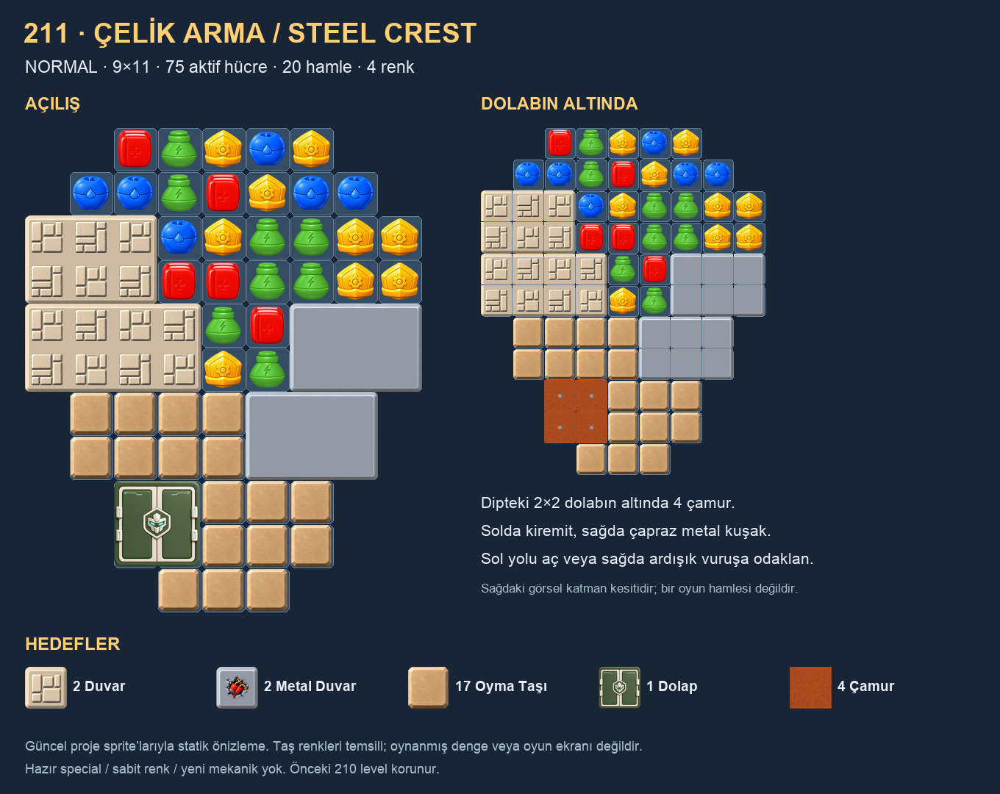

# 211 · Çelik Arma / Steel Crest

2026-11-03 · Normal · V1 `LevelCL_0211` · **28 hamle kullanıcıya kolay geldi; 20 hamle revizyonu denenmedi**.

Kullanıcı 211–220 için yeni engel tanıtımına ara verilmesini, mevcut engeller ve katmanlarla devam edilmesini istedi. Bu tur yalnız **211** yetkilendirildi. Görsel kompozisyon öncelikli; Wall/MetalWall örnekleri zorunlu bütün-onluk şablonu değildir.

## Kompozisyon ve oyun fikri

**9×11 sınır içinde 75 aktif hücre**, aşağı doğru kademeli daralan bir arma. Açılışta 28 normal taş yuvası var. Dış şekil dengeli; içteki asimetrik kuşak, iki eş kanat/orta koridor tekrarını kırıyor. Sol üstte iki ayrı kiremit parçası, sağ orta ve sağ altta iki ayrı metal parçası var. Alt taraftaki tek, bağlı oyma taşı bölgesi armayı tamamlıyor. Dipteki 2×2 dolap tek hücrelik yardımcı adacığı değildir; taş alanına bitişik, altında 2×2 çamur bulunan bir görev bölgesidir.

Oyuncu sol kiremit yolunda kalıcı hasar biriktirmeyi veya sağdaki metalde aynı hücreye art arda odaklanmayı seçer. Sol yol açılınca taş omurganın yanına daha geniş erişim gelir; sağ yol açılınca alt metal ve taşların sağ yüzü açılır. Taş omurga temizlendikten sonra dipteki dolap ve altındaki çamur işi kalır. Dolap daha erken special ile de açılabilir; bu tarif zorunlu bir komut sırası değildir.

| Ayar | Değer |
|---|---|
| Hamle | **20**, kullanıcı oyun geri bildirimiyle 28'den indirildi |
| Renk | 4 |
| Hedefler | 2 Wall · 2 MetalWall · 17 SculptingStone · 1 Wardrobe · 4 Mud |
| Duvar alanı | 14 kiremit hücresi / 2 parça; 12 metal hücresi / 2 parça |
| Katman | 4 Mud üzerinde 1 adet 2×2 Wardrobe |
| Hazır special / sabit renk | Yok |
| Refill special guard | 0.75 manuel başlangıç ayarı; runtime'ın mevcut yardım/başarısızlık davranışı değiştirilmedi |

Duvar hedefi hücre değil **parça** sayısıdır. Güncel runtime'da Wall aynı hücreye beş vuruşla yıkılır; MetalWall dört vuruş ister, vurulmayan hamlede hücre bir aşama geri gelir. Eski enum yorumundaki üç vuruş/tam sıfırlanma tanımı kullanılmadı. Katmanlı dolap iki vuruşlu; çamur altta kalır. Yeni mekanik veya runtime kodu eklenmedi.

## Tekrar ve görsel inceleme

210 önceki V1 levelin envanteri çıkarıldı; boyut/konum ve kırpılmış engel silueti ayrıca karşılaştırıldı. Yakın adaylar 183, 144, 114 ve 203; son 207–210 tahtaları da incelendi. Bunlar benzer geniş/altı dolu alanlara sahip; 211'in aşağı daralan maskesi, asimetrik kiremit-metal kuşağı ve dolap/çamur dip işi ayrı bir açılış kuruyor. Benzerlik skoru yenilik veya beğeni yüzdesi değildir.

İlk ajan taslağının iki eş kanadı fazla tanıdık bulundu ve **ajanın kendi görsel değerlendirmesiyle** revize edildi; kullanıcı reddi/onayı olarak kaydedilmedi. Önizleme güncel sprite'larla açılıp incelendi. Kiremit kabartmaları da mevcut kaynaklardan çizildi; normal taş renkleri ve kabartma varyasyonları temsilidir. Sağdaki görsel yalnız dolap kapağının kaldırıldığı **katman kesiti**, bir oynanış anı değildir; noktalı çamur yuvaları diğer katı engeller hâlâ yerinde olduğu için boş gösterilir.

## Doğrulama ve sınırlar

`Batches/211-Steel-Crest/verify.py`: gerçek YAML ayrıştırma, 99 elemanlı diziler, 75 aktif hücre, bağlı maske, origin/parça bağlantıları, 2×2 dolap ayak izi ve altındaki dört çamur, beş tam hedef, renkler ve katalog/isim eşleşmesi kontrol edildi. Açılıştaki 28 taş yuvasının tamamı statik dolum grafına erişiyor. Kiremitlerin, metallerin, taş omurganın ve dolap kapağının kaldırıldığı ayrı tam-aile kontrol noktalarında erişim incelendi; bu, bütün olası hasar durumlarını oynatan bir simülasyon değildir.

Önceki assetler/runtime/sahneler/prefablar hash ile korundu. Katalog yalnız 211 eklenerek uzatıldı; eski TR/EN adlar değişmedi. Güncel kayıt: [validation.json](Batches/211-Steel-Crest/validation.json). Karşılaştırma: [Comparison.png](Batches/211-Steel-Crest/Comparison.png).

Performans: dört mevcut duvar parçası, bir dolap ve mevcut taş/çamur hizmetleri kullanılır. Yeni tarama, Update, efekt veya ses kaynağı eklenmedi. Duvar hizmeti parça kurulumu/yıkımında mevcut listeler ve görseller oluşturur; tamamen havuzlu olduğu veya FPS iyileştiği iddia edilmiyor. Mevcut teardown abonelikleri kaldırır, parça görsellerini temizler; runtime/VFX/audio davranışları bu level için değiştirilmedi.

**Oyun geri bildirimi — 2026-11-03:** kullanıcı 28 hamleyle oynadı; “oldukça kolaydı, 10 hamle kaldı” dedi ve hamleyi azaltmamızı istedi. Yalnız `moves` **28→20** değişti. Aynı oynayış yaklaşık iki hamle pay bırakır; bu bir tasarım tahmini, ölçülmüş geçiş oranı değildir. Tahta, hedefler, katmanlar, renkler ve refill ayarı aynı. Güncel asset ve önizlemenin önceki hali `Batches/211-Steel-Crest/Revisions/v3-moves20/` içinde saklandı; değişiklik kaydı başka asset alanının değişmediğini doğrular.

**20 hamle henüz oynanmadı; ölçülmüş kazanma oranı yok.** Unity Play/build, bot/kaskat simülasyonu, yayın veya release baseline yapılmadı. Kullanıcı istemeden 212'ye geçilmez. Yeniden yazma gerekirse güncel assetten snapshot alınır; `author.py` eski kapsamı körlemesine tekrar uygulamak için kullanılmaz.
