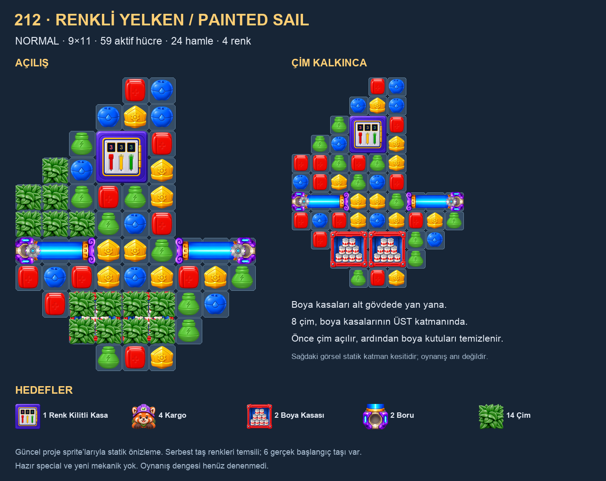

# 212 · Renkli Yelken / Painted Sail

2026-11-03 · Normal · V1 `LevelCL_0212` · **v2: alt boya kasaları, çim üstte**.

Kullanıcı yelken şeklini “çok güzel” buldu; siluet onaylı ve aynı. Boya kasalarını en alta, çimi de boya kasalarının üstüne istedi. Renk kilitli kasa aynı yerde korundu. Bu onay görsel siluete aittir; v2 oynanıp dengesi onaylanmış sayılmaz.

## Güncel yerleşim

**9×11 sınır içinde 59 aktif hücre; 24 hamle ve 4 renk.** İki 2×2 boya kasası alt gövdede yan yana, üstten 9–10. satırlarda. Onaylı maskenin son satırı üç hücre genişliğinde olduğundan iki kasanın birlikte sığabildiği en alt bant budur; son üç hücrelik tekne ucu aynen kaldı. Her kasanın dört hücresinin tamamında **üst katmanda Grass42** vardır. Veri sırası **PaintCanBox63 → Grass42**; çim artık boyanın altında değildir.

İki üç-hücrelik yatay boru bir üst gövde bandına, üstten 7. satıra taşındı. Arada tam bir eşleşme sırası kaldı. Borular küçüldükçe yan eşleşme alanı açılır; kargonun düşüşündeki esas alt kapak artık çimle örtülü boya kasalarıdır. Yelkenin solundaki altı mevcut çim ve üstteki 2×2 renk kilitli kasa korunur.

| Ayar | Değer |
|---|---|
| Hedefler | **1 Safe · 4 Cargo · 2 PaintCanBox · 2 Tube · 14 Grass** — aynı |
| Kasa | Aynı origin21; Ordered kırmızı → sarı → yeşil, **3/3/3** |
| Kargonun başlangıcı | Kasa altında dört hücre, origin21/22/30/31 — aynı |
| Boya kasaları | Origin74 ve76; ikisi de 2×2, altında başka engel yok |
| Çim | Yelkende 6; boya kasalarının üstünde 8; toplam14 |
| Borular | Origin54 sağa, origin62 sola; ikisi de uzunluk3 |
| Başlangıç taşları | 35 yuva doğal beslenir; gövde/alt uçta **6 gerçek renk pini** vardır |
| Hazır special | Yok |
| Refill special guard | 0.75 — aynı |

## Oyun ve katman ilişkisi

Renk kilidi açılınca dört kargo görünür ve düz düşüşe katılır. Her boya kasasının üstündeki çim kaldırılınca o kasanın kutuları hedeflenebilir; mevcut genel katman kuralı gereği aynı çok-hücreli parça başka hücresinde gömülüyken korunur. Kasa başına dokuz boya kutusu, normal isabette bir veya special isabetinde iki azalır. Çim, boya kutusuna giden ilk isabeti tüketir; ikisine birden hasar verdiği varsayılmadı. Boya kasası kalkınca altı normal taş/düşüş alanına döner. Kargo kırılarak sayılmaz; iki sütunda düz düşüp alt çıkışa ulaşır.

Önceki sürümdeki “boya temizlenince altından çim çıkar” fikri bu kullanıcı talebiyle tersine çevrildi. Yeni sıra **çim → boya kutuları → kargo çıkışı**. Bütün board için tek zorunlu komut sırası yoktur; oyuncu kasanın kilidini, çim kapaklarını veya boruları çalışabilir.

## Seçim ve karşılaştırma

İlk tasarımda güncel 76 ID tanımı/kullanım geçmişi ve üç aday oyun fikri değerlendirildi; renk/yön/aşama varyantları bağımsız aile sayılmadı. Renkli Yelken, kasa–kargo–boya–boru etkileşimiyle seçildi. Aile havuzu ve aday gerekçeleri `Batches/212-Painted-Sail/Pool-Review.json` içinde. 211 önceki V1 levelin yerleşim/siluet envanteri ve yakın görselleri incelendi; kullanıcı sonrasında yelken siluetini açıkça beğendi. Bu revizyonda başka referansa göre şekil değiştirilmedi.

Önizleme güncel sprite/prefab parçalarını kullanır. Çim, mevcut runtime'ın saydam üst örtü kuralına uygun biçimde alttaki boya kasasının üstünde çizilir; sağ görsel yalnız çim kaldırılmış statik katman kesitidir, oynanış anı değildir. Serbest taş renkleri temsili; altı pinin rengi assette gerçektir. Gerçek PNG açılıp incelendi.

## Doğrulama ve korunmuş veriler

Aktif kontrol: `python3 Docs/LevelDesign/Batches/212-Painted-Sail/verify.py` → `verify_bottom.py`.

- Gerçek YAML Ruby/Psych ile okundu. Maskenin 99 girdisi, 59 aktif hücre ve yelken silueti önceki snapshot ile aynı.
- İki boya kasasının 2×2 ayak izi/originleri ve her birinin üstündeki dört Grass girdisi kontrol edildi. Toplam beş hedefin miktarları aynı.
- Kasa, kilit sayaçları, Cargo başlangıçları, hamle, renkler, refill ayarı, isim, GUID/meta ve katalog değişmedi. Bu revision yalnız obstacle/origin, tubes, stackedObstacles ve pinnedTileTypes alanlarını düzenler.
- Açılıştaki 41 taş yuvasının 35'i doğal besleniyor; kalan altı hücre gerçekten pinli. Pinlerde başlangıç üçlüsü yok; alt uçtaki iki pin farklı renk olduğu için rastgele üçüncü taşla zorunlu yatay başlangıç üçlüsü oluşturmaz. Dolu açılış konumları yeni alt boş yuva bırakmıyor.
- Çim, boya ve boru kapakları kaldırılmış kontrol noktalarında erişim, düz Cargo sütunları ve çıkış devamlılığı incelendi. Bunlar yalnız statik tam-aile kontrol noktalarıdır; bütün olası runtime/gravity durumlarının simülasyonu değildir.
- Diğer Assets/_Project dosyaları yeni koruma kaydına göre hash ile aynı; kullanıcı 211'i kendisi 24 hamle yapmıştı, bu hali korundu.

Önceki v1 asset/meta/JSON/not/PNG ve çizici/doğrulayıcılar `Batches/212-Painted-Sail/Revisions/v2-grass-over-bottom/` içinde. Aynı klasörde `protected-before.json` bu revizyonun koruma kaydıdır. Güncel sonuç `validation.json`; aktif yazıcı `revise_bottom.py`. Eski `author.py` ve önceki taslak snapshot'ları yeni içeriğin üzerine körlemesine uygulanmaz.

Runtime/VFX/audio kodu değişmedi. Öncekiyle aynı bir Safe, iki Tube, iki PaintCanBox ve 14 Grass kullanılır; 18 boya kutusu görseli mevcut sistemle çalışır. Yeni update/tarama/coroutine/efekt/ses kaynağı eklenmedi; FPS kazancı veya tamamen havuzlu çalışma iddiası yok.

**v2 oynanmadı; ölçülmüş geçiş oranı/FPS yok.** Unity Play/build, bot/kaskat simülasyonu, yayın veya release baseline yapılmadı. Kullanıcı istemeden 213'e geçilmez.
