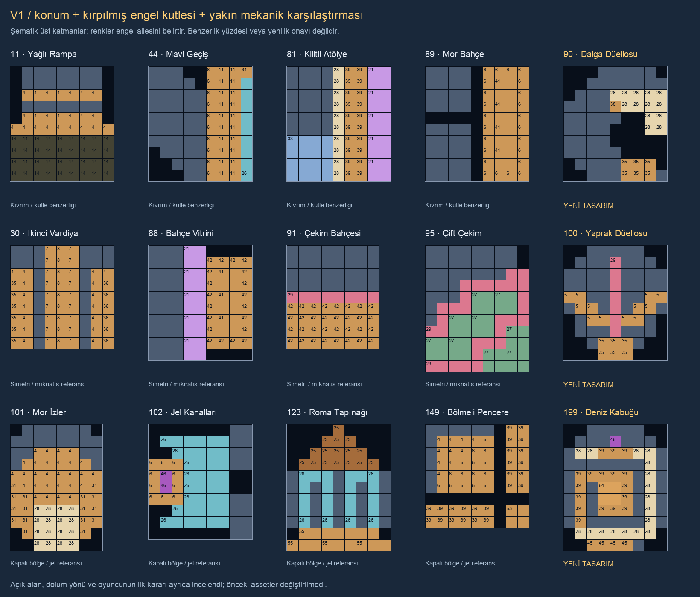

# V1 90 / 100 / 199 — tekrar ve açılma incelemesi

Yeni taslaklar, aktif **LevelCatalogProV1** sırasından karşılaştırıldı. Eski üretim
numarasının aynı görünmesi aynı level anlamına gelmez. Yardımcı araç artık isteğe
bağlı `--catalog` alır; varsayılan tarihsel katalog davranışı korunur.

- **90:** Konum adayları44/17/89 ve kırpılmış kütle adayı11 incelendi; yakın81 de
  karşılaştırmaya eklendi. 89 ve44'ün sağa dayalı kütlesiyle benzer tarafı vardır.
  Fark, geniş soldan kıvrılan dalga maskesi ve açık koydur; 13 oyma taşı düelloda
  isteğe bağlı alan açar. 11'deki yağlı yatay bent işi tekrarlanmıyor. Sadece engel
  adının değiştirilmesi yenilik gerekçesi sayılmadı.
- **100:** 88/30 simetri ve kütle;91/95 mıknatıs kullanımı için incelendi.
  91 yatay tek ayırıcı,95 üç ayrı kıvrımlı mıknatıs ve dolap alanıdır. Yeni yaprak
  tek dikey mıknatıs damarı ve ona yaklaşan iki bağlı basamakla genişler. İki yan
  kanat benzerliğinin kendisi reddedilmedi; alt uca erişim ve orta hattın açılması
  gerçek oynanış gerekçesidir. Başlangıçta alt odalar dolu varsayılmadı.
- **199:** Konum adayları123/131/101, kırpılmış kütle adayı102 ve benzer pencere149
  incelendi. Üst/bölgesel örtü ve iç oda ortak sözlüktür. Yeni yerleşimde tek
  kesintisiz spiral, üç hücrelik special kapısı, jel kaynaklı hazır TNT ve merkezde
  tek renk sayacı birlikte işler. 123'ün tapınak çatısı/duvar temeli,102'nin tüp
  kanalları,149'un bölmeli penceresi kopyalanmadı.

Araç sonuçları aday bulma yardımcısıdır; benzersizlik, kullanıcı beğenisi veya
oynanış dengesi ölçümü değildir. Yeni levellar henüz kullanıcı tarafından
onaylanmadı. 11–15 dahil önceki tasarımlar korunur.

Her alt klasörde `Similarity.json`, tam katalog envanteri ve yerleşim haritaları
var. Yeni üç gerçek-sprite PNG'si batch klasöründe ayrıca görsel olarak incelendi.

199 v2 (2026-10-29): Kullanıcının31→26 hamle ve kabuk içinde başlangıç taşı isteği
uygulandı. Maske/engel kütlesi değişmediği için geometri sıralaması yeniden
çalıştırılmadı. Güncel gerçek-sprite PNG'de iç18 yuva taşlıdır; önceki boş odalı
PNG `Batches/ProLevels-V1-090-100-199/Revisions/199-v1/` altında saklıdır.

199 v3 (2026-10-29): Kullanıcının kolaylık geri bildirimi üzerine2./3. satırdaki
yalnız dört jel tabanı kaldırılıp merkezdeki2×2 Ancient Seal altına taşındı.
Görünür engel kütlesi aynı; erken jelli TNT yayılımı yerine mühür sonrası kaplama
işi vardır. Geometri benzerlik puanları yeniden hesaplanmadı; oynanış dengesi
ölçülmedi. v2 snapshot/PNG batch `Revisions/199-v2/` altında saklıdır.
